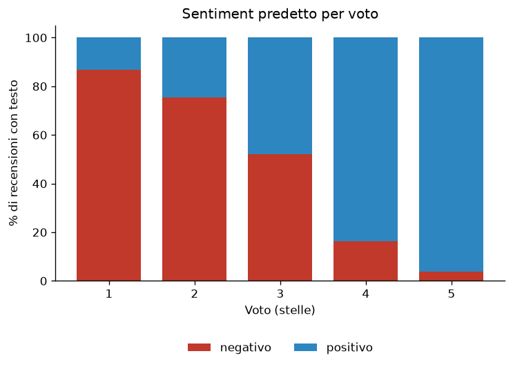
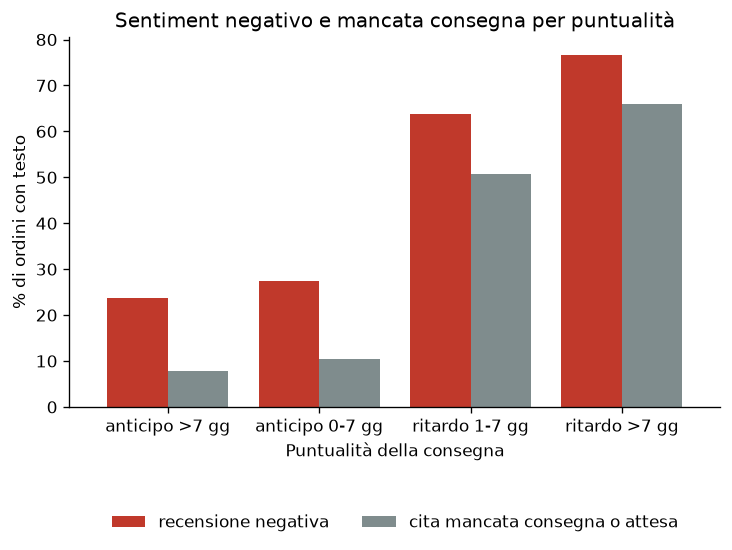
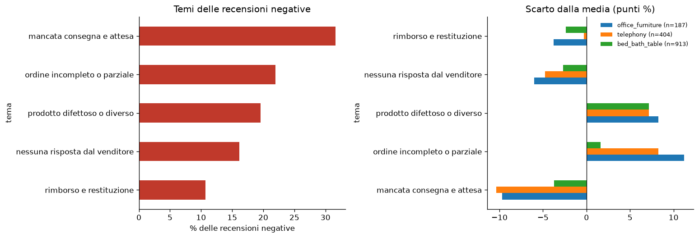
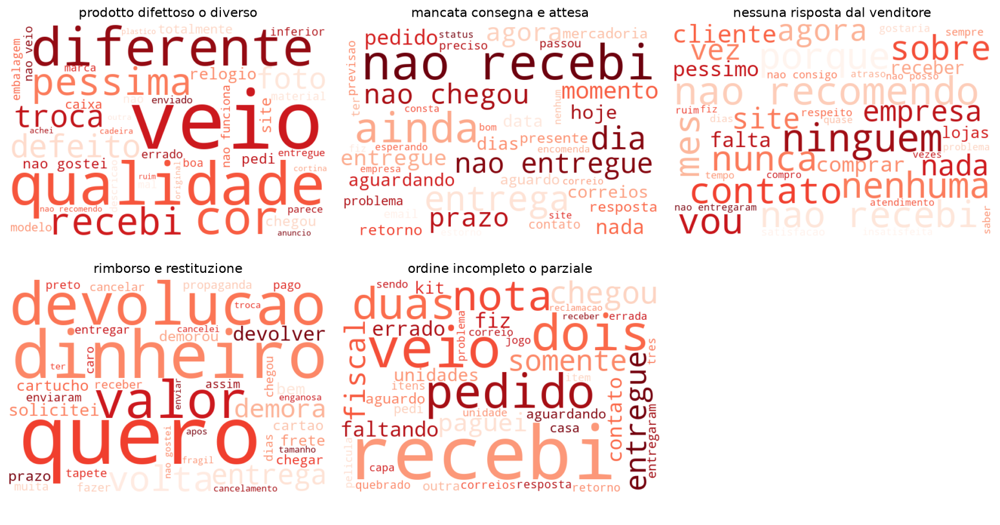

# Olist NLP: sentiment e temi nelle recensioni

Analisi del testo delle recensioni in portoghese del dataset e-commerce [Olist](https://www.kaggle.com/datasets/olistbr/brazilian-ecommerce): sentiment con un modello BERT, temi dei commenti negativi (TF-IDF e LDA) e collegamento con gli ordini del [progetto 1](LINK_PROGETTO_1) per verificare puntualità, geografia e categorie.

## Pipeline

| Fase | File | Contenuto |
|---|---|---|
| 1. Esplorazione e preprocessing | `olist-nlp.ipynb` | Quota di recensioni con testo, soglia minima di 3 caratteri, pulizia leggera; output in `reviews_text.pkl` |
| 2. Scelta del modello | `olist-nlp.ipynb` | Due modelli a confronto (`cardiffnlp/twitter-xlm-roberta-base-sentiment` e `lipaoMai/BERT-sentiment-analysis-portuguese`) su 300 recensioni stratificate per voto, con lettura a mano dei disaccordi |
| 3. Sentiment | `olist-nlp.ipynb` | `lipaoMai/BERT-sentiment-analysis-portuguese` su 40.656 recensioni con testo; output in `reviews_sentiment.pkl` |
| 4. Keyword e temi | `olist-nlp.ipynb` | Seconda versione del testo, TF-IDF per gruppo, LDA a 5 temi sui negativi |
| 5. Collegamento col progetto 1 | `olist-nlp.ipynb` | Sentiment per ordine, join con ordini, clienti e categorie; output in `order_sentiment.pkl` e `.csv` |
| 6. Grafici | `outputs/` | 4 figure (vedi sotto) |

## Grafici

Salvati in `outputs/`:

- **Sentiment per voto:** quota di recensioni negative e positive per ogni numero di stelle.
- **Puntualità:** quota di ordini negativi e di testi che citano mancata consegna, per fascia di puntualità.
- **Temi negativi:** quota di ogni tema e scarto dalla media nelle categorie con voto più basso.
- **Word cloud:** parole più pesanti di ognuno dei 5 temi.

## Risultati

### Sentiment vs stelle

### Puntualità della consegna

### Temi delle recensioni negative

### Word cloud dei temi

## Risultati principali

- **Modello:** su 300 recensioni il BERT scelto riconosce l'83% dei negativi e l'89% dei positivi (F1 0,86). Sulle 40.656 recensioni con testo: 68,6% positive, 31,3% negative; la quota di negativi scende con le stelle (86,8%, 75,3%, 52,0%, 16,2%, 3,7% per i voti da 1 a 5). Per ordine, la correlazione di Spearman tra probabilità di negativo e voto è -0,72.
- **Temi dei negativi** (LDA, 9.187 recensioni): mancata consegna e attesa 31,6%, ordine incompleto 21,9%, prodotto difettoso o diverso 19,6%, nessuna risposta dal venditore 16,2%, rimborso e restituzione 10,7%.
- **Puntualità:** i negativi passano dal 23,6% (anticipo oltre 7 giorni) al 76,7% (ritardo oltre 7 giorni); le recensioni che citano mancata consegna o attesa dal 7,7% al 65,9%.
- **Consegna:** parlarne non basta a distinguere i negativi (compare anche in "chegou antes do prazo"); distinguono le espressioni di mancata consegna o attesa: 43,7% dei negativi contro 2,5% dei positivi.
- **Geografia:** tra le recensioni negative la mancata consegna è citata più nel Nord (AC, AM, PA, RO, TO: gli stati del Nord con almeno 30 ordini con testo) che a São Paulo: 40,3% contro 30,3% (+10 punti, IC 95% da +3,5 a +16,5). Giorni mediani: 25,6 contro 8,7.
- **Categorie:** in office_furniture, bed_bath_table e telephony i negativi parlano più del prodotto (difettoso, diverso, incompleto) che della consegna rispetto alla media.
- **Riacquisto:** la prima recensione di chi riacquista non è più negativa di quella degli altri (29,9% contro 31,4%).

## Scelte metodologiche

- Modello scelto confrontando due candidati sullo stesso campione di 300 recensioni (60 per voto, `random_state=42`) e leggendo i disaccordi, perché le stelle non sono la verità.
- Testo quasi grezzo per i transformer: stopword, accenti e negazioni portano significato.
- Soglia minima di 3 caratteri: commenti brevi come "muito bom" sono informativi.
- Un ordine è negativo se la media delle probabilità di negativo delle sue recensioni è ≥ 0,5.
- Per keyword e temi solo le recensioni dove stelle e modello concordano (voto ≤ 2 e negativo; voto ≥ 4 e positivo).
- Seconda versione del testo per TF-IDF e LDA: minuscolo, senza accenti, stopword portoghesi tranne "não", "nem", "sem" (negazione unita alla parola successiva, es. `nao_recebi`) e stopword di dominio (produto, loja, compra…, più i nomi anonimizzati dei venditori tipo Lannister e Targaryen, che sporcavano i temi).
- LDA con K=5: coerenza c_v 0,391 (K=6 0,409, differenza piccola, temi più leggibili con 5).
- Stesso metodo del progetto 1: recensioni aggregate per ordine prima di ogni join, `validate=` e controllo delle righe, soglie scelte guardando l'output (30 ordini con testo per stato, 30 recensioni negative per categoria).
- Filtro `valid` per i tempi ricostruito con regola base: riproduce i numeri del progetto 1 (mediana 10,2 giorni, 6,8% in ritardo).
- Differenze tra gruppi con intervallo di confidenza al 95%.

## Limiti

- Solo il 41,3% delle recensioni ha un testo, e chi scrive è più estremo: i voti 1 sono il 21,3% tra le recensioni con testo contro l'11,5% su tutte.
- Il modello spinge il voto 3 verso un lato; circa il 12% dei negativi del campione sfugge a entrambi i modelli; con 300 recensioni il margine è circa ±13 punti.
- Il campione ha il 40% di negativi contro circa il 26% reale: la precisione sul negativo nel dataset intero è più bassa di quella misurata.
- 29 recensioni con una terza etichetta del modello (non "neutro") sono escluse; 49 recensioni senza lettere restano ma non hanno parole nell'analisi dei temi.
- I temi LDA e i loro nomi sono una lettura umana, controllata su esempi; "nessuna risposta dal venditore" è il meno netto.
- Il "Nord" sono 5 stati e 226 recensioni negative (146 dal Pará); anche altri stati e Rio de Janeiro hanno quote simili, quindi i tempi di consegna non spiegano tutto.
- Categorie: solo tre hanno un margine d'errore accettabile; ordini con più categorie o senza categoria scartati; il confronto è con la media di tutti i negativi.
- Il riacquisto è su un gruppo piccolo (1.263 clienti): solo indicativo.

## Come riprodurlo

1. Esegui prima il [progetto 1](LINK_PROGETTO_1) e copia `dfs_clean.pkl` in `processed data/` (con lo spazio; non è su Git).
2. Crea l'ambiente: `conda env create -f deeplearning.yml`
3. Nella prima cella del notebook cambia il percorso `HF_HOME` (cache dei modelli).
4. Esegui `olist-nlp.ipynb` (Restart & Run All). Il primo avvio scarica il modello (circa 268 MB) e le stopword NLTK. Serve una GPU CUDA (il codice usa `device=0`): il sentiment su tutte le recensioni richiede circa 100 secondi su una RTX 2060.

Nota: con `transformers` 5.17 e `torch` 2.5.1 il modello va caricato con `model_kwargs={"use_safetensors": True}`.

## Strumenti

Python (pandas, scikit-learn, gensim, NLTK, matplotlib, wordcloud), Hugging Face Transformers con PyTorch, JupyterLab, Git.
